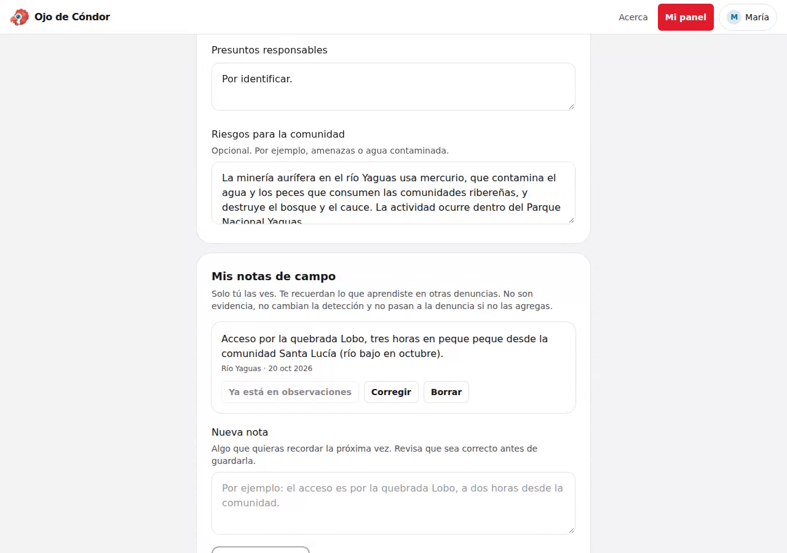
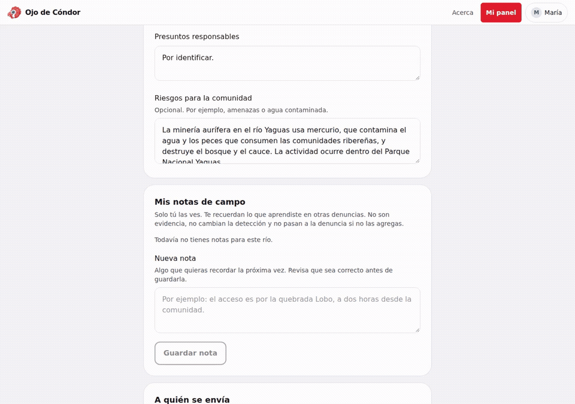

# Notas de campo entre denuncias

La captura y el video muestran la aplicación real en localhost con una alerta y una identidad sintéticas. Atomic Memory se sustituye por el proveedor HTTP local `backend/expedientes/tests/atomic_memory_fixture.py`. WhatsApp está desactivado, el correo usa memoria y no se accede a archivos reales de evidencia.

El video muestra guardar una nota de acceso, corregir dos horas por tres horas, agregarla explícitamente a observaciones y recuperarla al recargar el expediente. La nota corregida queda como único registro.

Para verificar la integración, inicia el entorno de pruebas local según `backend/README.md` y ejecuta `pytest expedientes/tests/test_notas.py`. Para probar visualmente con tu cuenta local, inicia `python -m expedientes.tests.atomic_memory_fixture --port 4610`, configura `ATOMIC_MEMORY_ENABLED=True`, `ATOMIC_MEMORY_API_URL=http://127.0.0.1:4610` y `ATOMIC_MEMORY_API_KEY=fixture-key`, y abre un expediente con una sesión de código de WhatsApp de ese mismo integrante. No uses credenciales ni datos de producción para esta demo.

[Video MP4](demo.mp4)
